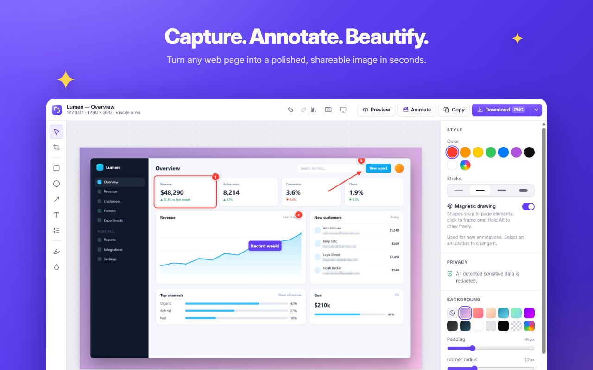

<p align="center"></p>

<p align="center"><strong>Screenshots that look finished.</strong><br>Capture, annotate and beautify screenshots — entirely on your device.</p>

<p align="center">
  <a href="https://github.com/berkayoner/snapframe/actions/workflows/ci.yml"></a>
  <a href="https://github.com/berkayoner/snapframe/releases/latest"></a>
  
  
  
  
  <br>
  <strong>English</strong> · <a href="README.tr.md">Türkçe</a>
</p>



SnapFrame is a Manifest V3 browser extension for Chrome and Edge. It takes
visible-area, selected-area and full-page screenshots, opens them in a fast
annotation editor, and exports polished images with backgrounds, shadows and
device mockups. There are no accounts and no network requests: captures live
in the browser's IndexedDB and never leave the machine.

## Install

- **Chrome Web Store:** coming soon.
- **From a release:**
  1. Download `snapframe-<version>-chrome.zip` from the [Releases](../../releases) page and unzip it.
  2. Open `chrome://extensions` (or `edge://extensions`) and turn on **Developer mode**.
  3. Click **Load unpacked** and select the unzipped folder.
  4. Pin SnapFrame to the toolbar.
- **From source:** see [Development](#development) below.

## Features

**Capture**

- **Visible area**, **select area** (on-page crosshair overlay with live size), **element** (hover any card, button or section, use ↑/↓ for its parent/child, click to capture exactly it) and **full page** (scroll & stitch).
- A shutter flash plays as you capture; the selection flies into the toolbar.
- Full-page capture shows sticky headers once at the top and fixed bottom bars (cookie banners, chat bubbles) once at the bottom, hides scrollbars, handles smooth-scrolling pages, and puts the page back where the user left it.
- Works from the toolbar popup, keyboard shortcuts and the right-click menu. Errors from shortcuts and the context menu appear as a badge on the toolbar icon.
- Correct on HiDPI and fractional-scaling displays: canvas sizes are measured from the captured bitmap and kept within browser canvas limits.

**Edit**

- Tools: select, crop (free or 1:1, 4:3, 16:9, 4:5, 9:16), rectangle, ellipse, arrow (endpoint handles), text labels, numbered steps, highlighter, blur/pixelate redaction.
- Color palette, stroke widths and fill modes. Multi-select with marquee or Shift, group move, resize handles, front/back ordering, duplicate, copy/paste.
- Zoom (fit, 100%, Ctrl/⌘ + wheel at the cursor), undo/redo, and a full keyboard shortcut set (press `?` in the editor).
- **Page-aware editing:** SnapFrame remembers the captured page's layout.
  - Shapes snap to real element edges, with guide lines.
  - A single click with the rectangle, ellipse, highlight, blur or crop tool frames the element under the pointer.
  - Hold Alt to draw freely.
- **One-click redaction:** emails, phone numbers, card numbers (Luhn-checked), IBANs (mod-97), Turkish ID numbers (checksum) and common API keys in the captured page are detected. "Redact all" pixelates them in one undoable step.
- Motion that explains: the active-tool indicator glides, zoom eases around the center, new steps and labels pop in, and redactions sweep in.
- Edits autosave; closing the tab or browser never loses work.

**Export**

- Optional frame: backgrounds (gradients, solids, custom color, transparent) with padding, corner radius and shadow. Exports are the plain screenshot until a background is picked.
- Browser, laptop, phone and tablet mockups, shown live in the editor. Frames wrap the screenshot at its own aspect ratio, never cropping it, and phones and tablets turn to landscape for wide screenshots.
- PNG or JPG (with quality), 1× or 2×, download or copy to the clipboard. The exact output can be previewed first.
- **Animated export (MP4, WebM, GIF):**
  - Annotations appear one by one. Arrows draw themselves, outlines trace in, the highlighter sweeps and steps pop.
  - An optional camera glides to each annotation and pulls back at the end.
  - Encoded on-device with WebCodecs, with a live preview before export.
  - MP4 needs a platform H.264 encoder (Chrome, Edge). WebM and GIF work everywhere.

**Library**

- Holds the 30 most recent captures, with search, download and delete.
- Import any image by file picker, drag & drop, or paste with Ctrl/⌘+V.

**Onboarding**

- A welcome page opens on first install, with pinning, the user's actual shortcuts and the privacy promise.

**Quality**

- A full design language (logo, Iris and Spark palette, bundled Inter typeface, tokens): see [docs/brand](docs/brand/README.md).
- Light and dark themes (follows the OS, or set your own), keyboard accessible, `prefers-reduced-motion` aware.
- English and Turkish UI that follows the browser language (`public/_locales`).
- Least-privilege permissions: `activeTab`, `scripting`, `contextMenus`. No host permissions.

## Keyboard shortcuts

| Action                   | Default                                                 |
| ------------------------ | ------------------------------------------------------- |
| Capture visible area     | `Alt+Shift+S`                                           |
| Select area              | `Alt+Shift+A`                                           |
| Capture element          | not set (assign one at `chrome://extensions/shortcuts`) |
| Capture full page        | `Alt+Shift+F`                                           |
| Open the SnapFrame popup | `Alt+Shift+X`                                           |

Change them at `chrome://extensions/shortcuts`. If a default key is already
taken by the browser or another extension, the browser leaves that shortcut
unassigned. Editor shortcuts are listed in the app (press `?`).

## Development

Requirements: Node.js 20+ and npm.

```sh
npm install          # also runs `wxt prepare` (generated types)
npm run dev          # dev build with hot reload -> .output/chrome-mv3-dev
npm run build        # production build -> .output/chrome-mv3
npm run zip          # store-ready zip in .output/
```

Load it in Chrome or Edge: open `chrome://extensions` (or `edge://extensions`),
enable **Developer mode**, click **Load unpacked**, and pick
`.output/chrome-mv3` (or `chrome-mv3-dev` while `npm run dev` is running).

### Quality checks

```sh
npm run check        # typecheck + ESLint + Prettier + unit tests (same as CI)
npm run test         # Vitest unit tests
npm run build:e2e    # test build: adds <all_urls> and test hooks, never shipped
npm run test:e2e     # drives the e2e build in a real browser (Playwright)
```

The end-to-end suite (`tests/e2e/run.mjs`) loads the extension into Chromium,
runs every capture mode against a local test page and checks the actual
pixels: no overlay in area captures, sticky and fixed bars appearing once,
scroll restoration. It also drives the editor with the mouse and keyboard and
verifies the export size. Options:

- `--channel=msedge` uses an installed Microsoft Edge. Branded Google Chrome
  has ignored `--load-extension` since version 137.
- `--lang=tr` runs the suite with the Turkish UI.
- `--headed` shows the browser window.

Screenshots of every screen are written to `tests/e2e/.artifacts/`.

### Brand & store assets

- `npm run brand` builds the outlined logo lockups and every icon (`public/icon/*.png`, `store/icon-128.png`) from `branding/`.
- `npm run build:e2e && npm run store -- --channel=msedge` regenerates the Chrome Web Store screenshots and promo tiles (English and Turkish) from the real extension. See [store/README.md](store/README.md) for the full publishing kit, including listing text and permission justifications.

### Other scripts

- `npm run lint:fix` and `npm run format` apply ESLint and Prettier fixes.

## Architecture

```
entrypoints/
  background.ts        service worker: capture orchestration, shortcuts, context menus, badge
  capture-overlay.ts   on-demand area-selection overlay (closed shadow DOM)
  popup/               toolbar popup
  welcome/             onboarding page (opened on first install)
  editor/              editor page
  library/             capture library page
src/
  capture/             capture modes, page-injected functions, geometry (pure)
  editor/              editor state (zustand), Konva canvas, tools, inspector, export actions
  annotations/         per-annotation styles, tools and pure style operations
  export/              final render pipeline, encoding, clipboard
  mockups/             device frame geometry (shared by editor DOM and export canvas)
  storage/             Dexie (IndexedDB) schema, history, autosave, image import
  shared/              i18n, theme, design tokens, messages, prefs, UI primitives
tests/
  unit/                Vitest
  e2e/                 Playwright extension tests
```

Key design decisions:

- **Pixels never travel through messaging.** Every capture mode writes its
  image straight to IndexedDB and passes only a `captureId` to the editor,
  because Chrome can't structured-clone Blobs to or from a service worker.
- **Single document model.** Every object (including the locked base
  screenshot) is `{ type, x, y, width, height, style }` in image pixels.
  Cropping re-bases positions instead of re-rasterizing, so it stays undoable.
- **Units.** Stroke widths, font sizes and frame padding are set in the
  source page's CSS pixels and multiplied by the capture's pixel ratio. A
  2× capture therefore looks the same as a 1× capture, at any zoom and any
  export scale.
- **One render path.** Download, Copy and Preview share
  `renderFinalCanvas`, so the preview is always exactly what gets exported.
  Editor-only nodes (handles, crop shading, drafts) are named `ui` and hidden
  during export.
- **Redaction is destructive.** Blur and pixelate regions are re-sampled from
  the original screenshot and drawn over it, so the exported file never
  contains the original pixels underneath.

## Privacy

SnapFrame makes no network requests and collects no data. See [PRIVACY.md](PRIVACY.md).

## Contributing

Bug reports, ideas, translations and pull requests are welcome. Read
[CONTRIBUTING.md](CONTRIBUTING.md) to get set up, and report security issues
privately as described in [SECURITY.md](SECURITY.md). This project follows
the [Code of Conduct](CODE_OF_CONDUCT.md).

## License

[MIT](LICENSE) © 2026 Berkay Öner. Bundled third-party software and fonts
are listed in [THIRD_PARTY_NOTICES.md](THIRD_PARTY_NOTICES.md).
