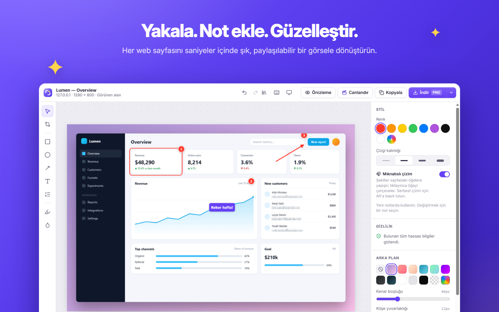

<p align="center"></p>

<p align="center"><strong>Bitmiş görünen ekran görüntüleri.</strong><br>Ekran görüntüsü alın, üzerine not ekleyin ve güzelleştirin — tamamen cihazınızda.</p>

<p align="center">
  <a href="https://github.com/berkayoner/snapframe/actions/workflows/ci.yml"></a>
  <a href="https://github.com/berkayoner/snapframe/releases/latest"></a>
  
  
  
  
  <br>
  <a href="README.md">English</a> · <strong>Türkçe</strong>
</p>



SnapFrame, Chrome ve Edge için bir Manifest V3 tarayıcı eklentisidir. Görünen
alanı, seçilen bir bölgeyi, tek bir öğeyi ya da tam sayfayı yakalar; hızlı bir
düzenleyicide not eklemenizi sağlar ve arka plan, gölge, cihaz çerçevesi ve
hatta animasyonla şık görseller olarak dışa aktarır. Hesap yoktur, ağ isteği
yoktur: çekimler tarayıcının IndexedDB'sinde kalır ve cihazdan hiç çıkmaz.

## Kurulum

- **Chrome Web Store:** yakında.
- **Sürüm paketinden:**
  1. [Releases](../../releases) sayfasından `snapframe-<sürüm>-chrome.zip` dosyasını indirip açın.
  2. `chrome://extensions` (ya da `edge://extensions`) sayfasında **Geliştirici modu**nu açın.
  3. **Paketlenmemiş öğe yükle** düğmesine basıp açtığınız klasörü seçin.
  4. SnapFrame'i araç çubuğuna sabitleyin.
- **Kaynak koddan:** aşağıdaki [Geliştirme](#geliştirme) bölümüne bakın.

## Özellikler

**Yakalama**

- **Görünen alan**, **alan seçme** (canlı boyut gösteren artı imleç), **öğe**
  (bir kartın, düğmenin ya da bölümün üstüne gelin; ↑/↓ ile üst/alt öğeye
  geçin, tıklayın) ve **tam sayfa** (kaydırıp birleştirme).
- Tam sayfada yapışkan başlıklar en üstte, çerez çubukları en altta bir kez
  görünür. Kaydırma çubuğu görüntüye girmez, sayfa eski konumuna döner.
- Popup, klavye kısayolları ve sağ tık menüsüyle çalışır. Çekim anında
  deklanşör efekti oynar.

**Düzenleme**

- Seç, kırp (serbest ya da 1:1, 4:3, 16:9, 4:5, 9:16), dikdörtgen, elips, ok,
  metin etiketi, numaralı adım, vurgulayıcı, bulanıklaştırma ve
  pikselleştirme.
- **Sayfayı tanır:**
  - Şekiller sayfadaki gerçek öğelerin kenarlarına yapışır.
  - Tek tık, imlecin altındaki öğeyi çerçeveler.
  - Serbest çizim için Alt tuşuna basılı tutun.
- **Tek tıkla gizleme:** sayfadaki e-posta, telefon, kart numarası (Luhn), IBAN
  (mod-97), TC kimlik no (sağlama) ve API anahtarları bulunur; "Tümünü gizle"
  hepsini tek adımda pikselleştirir. Tarih, fiyat ve sipariş numaraları
  bilerek yok sayılır.
- Çoklu seçim, katman sırası, geri al/yinele, yakınlaştırma ve her araç için
  kısayol (düzenleyicide `?`). Değişiklikler kendiliğinden kaydedilir.

**Dışa aktarma**

- İsteğe bağlı arka plan, kenar boşluğu, köşe yuvarlaklığı ve gölge.
- Tarayıcı, dizüstü, telefon ve tablet çerçeveleri. Ekran görüntüsünü asla
  kırpmaz ve editörde canlı görünür.
- 1× veya 2× PNG/JPG, panoya kopyalama ve birebir ön izleme.
- **Animasyonlu dışa aktarma (MP4, WebM, GIF):**
  - Notlar sırayla belirir; isteğe bağlı kamera her nota yakınlaşır.
  - Video cihazda, WebCodecs ile üretilir.

**Kütüphane**

- Son 30 çekim: arama, indirme ve silme. Herhangi bir görüntüyü dosya
  seçerek, sürükleyip bırakarak ya da Ctrl+V ile içe aktarabilirsiniz.

**Kalite**

- Logo, renk paleti, gömülü Inter fontu ve tasarım değişkenleriyle eksiksiz
  bir [tasarım dili](docs/brand/README.md).
- Açık ve koyu tema, klavye erişilebilirliği ve hareket azaltma tercihine
  uyum.
- Tarayıcı diline göre Türkçe veya İngilizce arayüz.
- En az yetki: yalnızca `activeTab`, `scripting` ve `contextMenus`. Ana
  makine (host) izni yoktur.

## Klavye kısayolları

| İşlem                  | Varsayılan                                       |
| ---------------------- | ------------------------------------------------ |
| Görünen alanı yakala   | `Alt+Shift+S`                                    |
| Alan seç               | `Alt+Shift+A`                                    |
| Öğe yakala             | yok (`chrome://extensions/shortcuts` ile atayın) |
| Tam sayfayı yakala     | `Alt+Shift+F`                                    |
| SnapFrame popup'ını aç | `Alt+Shift+X`                                    |

## Geliştirme

Gereksinimler: Node.js 20+ ve npm.

```sh
npm install          # WXT tiplerini de üretir
npm run dev          # canlı yeniden yüklenen geliştirme derlemesi
npm run build        # üretim derlemesi -> .output/chrome-mv3
npm run check        # tip kontrolü + ESLint + Prettier + birim testleri (CI ile aynı)
npm run build:e2e && npm run test:e2e   # uçtan uca testler (Playwright)
```

Ayrıntılar için [CONTRIBUTING.md](CONTRIBUTING.md) ve İngilizce
[README](README.md) içindeki mimari bölümüne bakın.

## Gizlilik

SnapFrame hiçbir ağ isteği yapmaz ve veri toplamaz. Ayrıntılar
[PRIVACY.md](PRIVACY.md) dosyasında.

## Lisans

[MIT](LICENSE) © 2026 Berkay Öner. Paketle gelen üçüncü taraf yazılım ve
fontlar [THIRD_PARTY_NOTICES.md](THIRD_PARTY_NOTICES.md) dosyasında
listelenmiştir.
