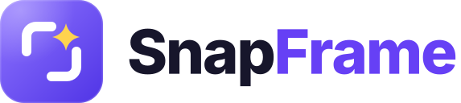

# SnapFrame design language

This guide describes how SnapFrame looks, moves and speaks. Every value here
is also a token in [`src/shared/theme.css`](../../src/shared/theme.css), and
every brand asset is generated by `npm run brand` from the sources in
[`branding/`](../../branding).



## Principles

1. **Your content is the hero.** The UI is calm and neutral so screenshots
   stand out. Chrome (toolbars, panels) recedes, and the canvas is where the
   color is.
2. **Calm surfaces, vivid moments.** Iris violet is for primary actions,
   selection and focus. Spark yellow is for small moments of delight:
   the logo, illustrations and the welcome page. Neither appears on ordinary
   surfaces.
3. **Clear before clever.** Plain words, visible shortcuts, and no hidden
   gestures without a visible alternative.
4. **Private by design.** We say it plainly and we mean it: no accounts, no
   uploads, no tracking.

## Logo

The mark is two crop corners framing a spark, on the Iris gradient. It
stands for _frame_ (capture and crop) and _snap_ (instant polish).

| Asset                                                                 | Use                                             |
| --------------------------------------------------------------------- | ----------------------------------------------- |
| [`logo-mark.svg`](../../branding/logo-mark.svg)                       | App icon, favicons, avatars (24px and up)       |
| [`logo-mark-small.svg`](../../branding/logo-mark-small.svg)           | Pixel-tuned master for 16–23px (toolbar icon)   |
| [`logo-horizontal.svg`](../../branding/logo-horizontal.svg)           | Lockup on light backgrounds                     |
| [`logo-horizontal-dark.svg`](../../branding/logo-horizontal-dark.svg) | Lockup on dark or brand-gradient backgrounds    |
| [`logo-wordmark.svg`](../../branding/logo-wordmark.svg)               | Wordmark alone, when the mark is already nearby |

- **Wordmark:** "Snap" in Ink, "Frame" in Iris 600 (Iris 300 on dark). Inter
  ExtraBold, tracking −3%, outlined in the SVG files.
- **Clear space:** keep at least half the mark's height empty around the
  lockup.
- **Minimum size:** the mark down to 16px (using the small master), the
  lockup down to 96px wide.
- **Don't** recolor the mark, rotate it, put it on a busy photo, add
  effects other than the subtle drop shadow used in the UI, or set
  "SnapFrame" in another typeface.

In code, use `<LogoMark />`, `<Wordmark />` or `<Logo />` from
`src/shared/Logo.tsx`. Never paste the SVG inline.

## Color

### Brand

| Token           | Hex                        | Use                                                            |
| --------------- | -------------------------- | -------------------------------------------------------------- |
| `--sf-iris-50`  | `#F4F1FF`                  | Tinted backgrounds                                             |
| `--sf-iris-200` | `#D6CBFF`                  | Illustration fills                                             |
| `--sf-iris-300` | `#B5A3FF`                  | Accent text on dark                                            |
| `--sf-iris-500` | `#7A5BFF`                  | Primary in dark theme, canvas selection handles                |
| `--sf-iris-600` | `#6640F5`                  | **Primary**: buttons, active states, focus (light theme)       |
| `--sf-iris-700` | `#5531D6`                  | Primary hover, accent text on light                            |
| `--sf-spark`    | `#FFD34E`                  | Delight accents only (logo, illustrations), never for UI state |
| Brand gradient  | `#8F75FF → #5034E6` (135°) | Logo tile, hero panels, store art                              |

White on Iris 600 passes WCAG AA (5.8:1).

### Neutrals (Ink)

Neutrals carry a faint violet tint so they sit naturally next to the brand.
Light theme: background `#F7F7FA`, surface `#FFFFFF`, border `#E4E4EC`, text
`#17162B`, muted text `#5E5D72`. Dark theme: background `#0F0E15`, surface
`#17161F`, border `#2A2937`, text `#EEEDF5`, muted text `#A3A1B8`.

### Semantic

Components use only semantic tokens (`--sf-bg`, `--sf-surface`, `--sf-fg`,
`--sf-fg-muted`, `--sf-accent`, `--sf-danger`, …), which switch between the
light and dark values. Don't hard-code hex colors in components. The only
exceptions are Konva canvas colors (`CANVAS_ACCENT`, which must match
`--sf-iris-500`) and the annotation palette, which belongs to the user's
content.

## Typography

**Inter Variable** (optical sizes), bundled with the extension (Latin and
Latin Extended, enough for English and Turkish). It is loaded locally and
never from a CDN.

| Token            | Size | Use                            |
| ---------------- | ---- | ------------------------------ |
| `--sf-text-xs`   | 11px | Eyebrows, badges, captions     |
| `--sf-text-sm`   | 12px | Secondary labels, metadata     |
| `--sf-text-base` | 13px | **Body / UI default**          |
| `--sf-text-md`   | 14px | Emphasized body, dialog titles |
| `--sf-text-lg`   | 16px | Section and card titles        |
| `--sf-text-xl`   | 20px | Page titles                    |
| `--sf-text-3xl`  | 44px | Marketing and hero headlines   |

- Weights: 400 body, 550–600 labels and buttons, 700 titles, 800 display.
- Tracking: −1% at 16px and up, −3.5% for display sizes.
- Numbers that change (sizes, zoom, counts) use tabular figures (`.num` or
  `font-variant-numeric: tabular-nums`).
- Eyebrow labels (`.eyebrow`) are 11px, bold, uppercase, +8% tracking, in
  accent text color.

## Shape & elevation

- Radius: 4 (badges), 6 (inputs), **8 (buttons, default)**, 12 (cards,
  menus), 16 (feature cards), 24 (hero panels). Pills use 999px.
- Shadows are soft and violet-tinted in light mode: `--sf-shadow-sm` for
  resting controls, `--sf-shadow` for cards and floating bars,
  `--sf-shadow-lg` for dialogs and menus, `--sf-shadow-accent` for the
  primary-button hover glow.
- Primary buttons have a 14% white top sheen and an inset highlight.

## Motion

- `--sf-duration-fast` (120ms) for hover and press, `--sf-duration` (180ms)
  for entering elements, `--sf-ease` = `cubic-bezier(.2, .8, .2, 1)`.
- Motion explains, never decorates: toasts slide up 8px, and pressed buttons
  sink 0.5px.
- `prefers-reduced-motion` turns animations off globally.

## Iconography

- [Lucide](https://lucide.dev) icons, stroke 1.8–1.9, at 15–18px in
  controls.
- Icon-only buttons always have an `aria-label` and a tooltip with the
  keyboard shortcut.
- No emoji in the UI.

## Illustration

Illustrations are built from the logo's own parts: the gradient panel, a
white screenshot card with window dots, Iris crop corners and Spark sparkles,
plus at most one red annotation as a hint of the product. See
`src/shared/Illustration.tsx` and the welcome page's hero.

## Voice & tone

- **Short, plain, friendly.** "Copied to clipboard", not "The image has been
  successfully copied to your clipboard."
- **Sentence case** for everything (buttons, titles, menus).
- **Verbs for actions:** Capture, Download, Copy, Import, Delete.
- **Errors say what to do next:** "This page can't be captured. Try a
  regular website."
- **Turkish** uses the polite _siz_ form and natural phrasing, not word-for-word
  translation: "Görünen alanı yakala", "Panoya kopyalandı".

## Regenerating assets

```sh
npm run brand                                      # logo SVG lockups + extension icons + store icon
npm run build:e2e && npm run store -- --channel=msedge   # store screenshots + promo tiles (en, tr)
```
